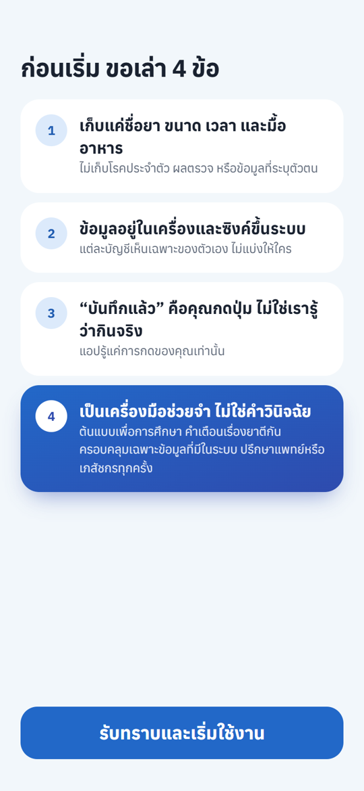
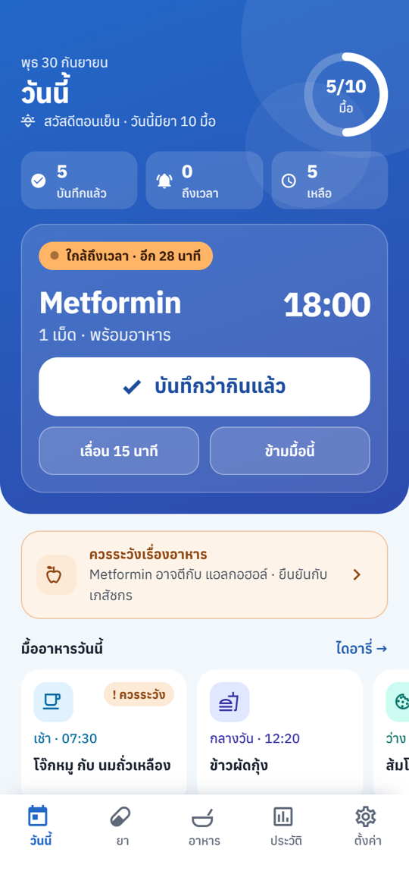
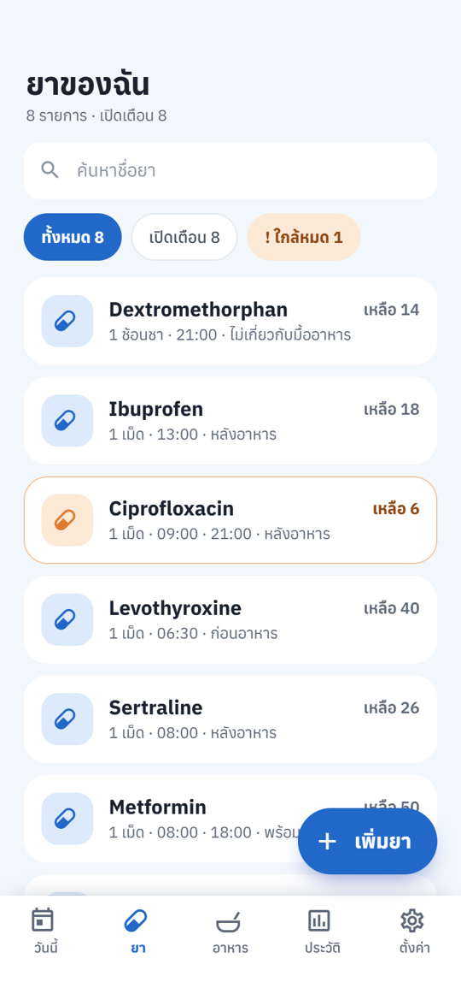
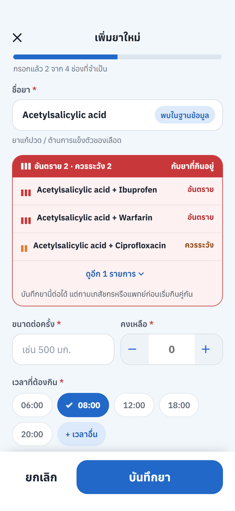
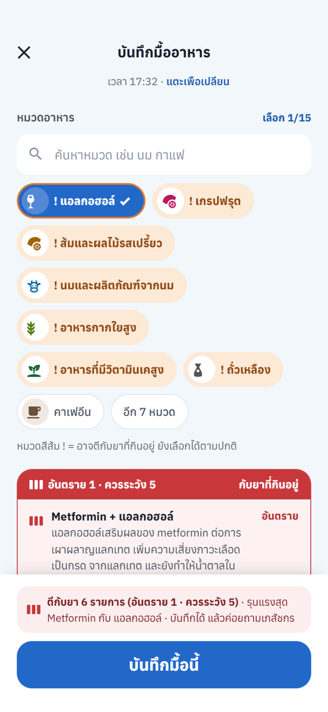
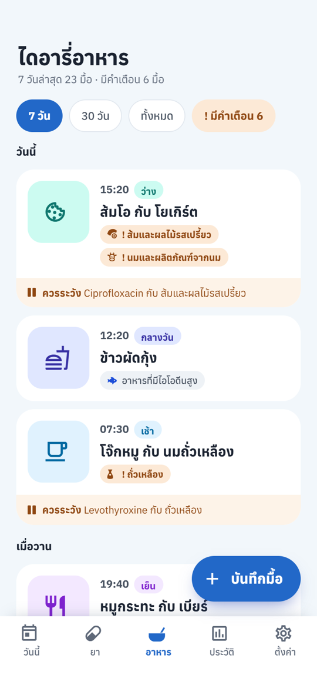
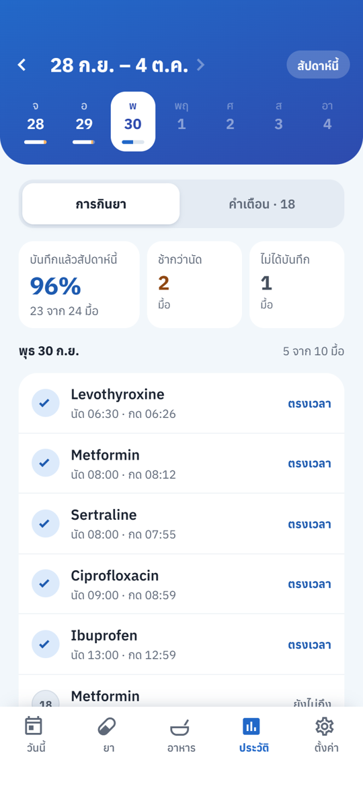
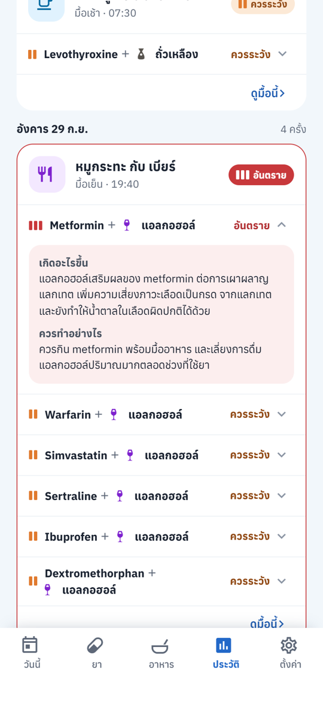
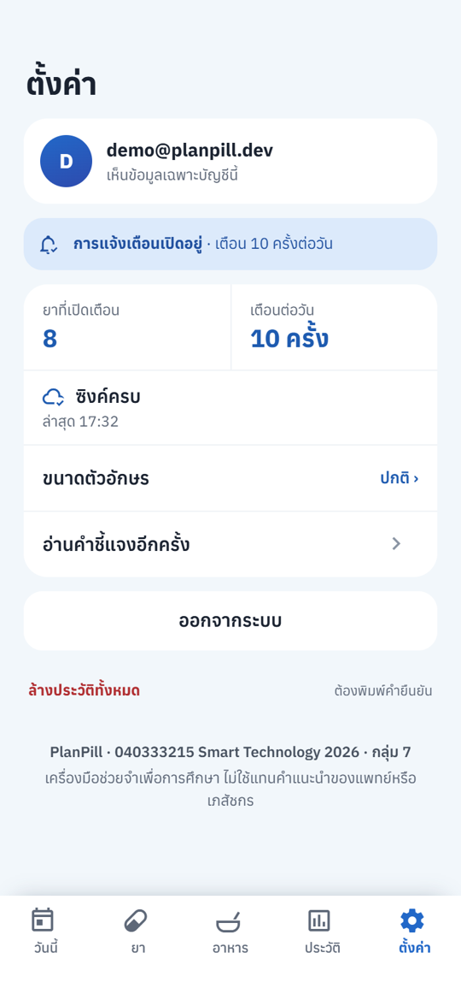

# PlanPill

แอปไดอารี่บันทึกมื้ออาหารร่วมกับการรับประทานยา พร้อมระบบตรวจสอบปฏิกิริยาระหว่างยากับยา และยากับอาหาร

> **ระบบต้นแบบเพื่อการศึกษา** ในรายวิชา 040333215 Smart Technology 2026
> ไม่ใช่อุปกรณ์วินิจฉัยหรือรักษาทางการแพทย์จริง
> ระบบบันทึกจากการกรอกและกดยืนยันของผู้ใช้เท่านั้น จึงไม่สามารถยืนยันได้ว่า
> ผู้ใช้รับประทานยาหรืออาหารจริงตามที่บันทึก
> คำเตือนเรื่องปฏิกิริยาครอบคลุมเฉพาะข้อมูลที่คัดเลือกเข้าระบบ ไม่ใช้แทนคำแนะนำจากแพทย์หรือเภสัชกร

---

## สมาชิกในกลุ่มและบทบาท (กลุ่ม 7)

| รหัสนักศึกษา | ชื่อ | บทบาท |
|---|---|---|
| 6704035612190 | นาย กมล จันทร์สำราญ | Frontend |
| 6704035613013 | นาย จิระ พนิชย์สกุล | Backend / Database |
| 6704035613081 | นางสาว ภูริชญา ผลจันทร์ | Data & Integration |
| 6704035613129 | นางสาว กัณญิกา ชีพสมุทร | UI/UX & Testing |

## ปัญหาและแรงจูงใจ

ยาหลายชนิดมีเงื่อนไขการรับประทานที่สัมพันธ์กับมื้ออาหาร (ก่อน / หลัง / พร้อมอาหาร)
และยังมีปฏิกิริยาระหว่างยากับยา รวมถึงระหว่างยากับอาหารบางประเภทที่ผู้ใช้ทั่วไปไม่ทราบ
เช่น ยากลุ่ม statin กับเกรปฟรุต หรือ tetracycline กับนม

ปัจจุบันผู้ใช้บันทึกมื้ออาหารและการรับประทานยาแยกกัน จึงตรวจสอบย้อนหลังไม่ได้
และไม่มีเครื่องมือเตือนล่วงหน้า PlanPill จึงรวมการบันทึกทั้งสองอย่างไว้ในไทม์ไลน์เดียวกัน
แล้วเชื่อมข้อมูลยาเข้ากับฐานข้อมูลปฏิกิริยาที่ผ่านการตรวจสอบทางวิชาการ (DDInter 2.0)

**ผู้ใช้เป้าหมาย:** นักศึกษาและวัยทำงานที่รับประทานยาหรืออาหารเสริมเป็นประจำ
(วิตามิน ยาแก้แพ้ ยาลดกรด ยาคุมกำเนิด)

---

## สถานะการพัฒนา

โปรเจกต์นี้เริ่มจากแอปเตือนกินยาที่ต่อกับเซนเซอร์ ESP32
แล้วเปลี่ยนทิศทางเป็นไดอารี่อาหารและยา โดยตัดส่วนฮาร์ดแวร์ออกทั้งหมด

| ส่วน | สถานะ |
|---|---|
| จัดการยา / ตารางมื้อยา / ประวัติ / ส่งออกข้อมูล | เสร็จแล้ว |
| การแจ้งเตือนตามเวลา + เตือนซ้ำ | เสร็จแล้ว |
| Supabase Auth (อีเมล + รหัสผ่าน) | เสร็จแล้ว |
| Supabase Database + Row Level Security | เสร็จแล้ว |
| ทำงานออฟไลน์ได้ (cache + คิวอัปโหลด) | เสร็จแล้ว |
| ไดอารี่มื้ออาหาร + ถ่ายรูป (Supabase Storage) | เสร็จแล้ว |
| ตรวจปฏิกิริยา ยา-ยา / ยา-อาหาร | เสร็จแล้ว |
| นำเข้าข้อมูลอ้างอิงจาก DDInter 2.0 + แปลไทย | เสร็จแล้ว (ยา 61 ตัว) |
| ค้นหาชื่อยาด้วยชื่อไทย / ชื่อการค้า (fuzzy search) | เสร็จแล้ว |
| UI ชุด Sky ตามไฟล์ออกแบบ | เสร็จแล้ว |

---

## ฟีเจอร์

### แต่ละแท็บทำอะไร

| แท็บ | ทำอะไรได้ |
|---|---|
| **วันนี้** | มื้อยาของวันนี้แยกตามช่วงเวลา วงแหวนความคืบหน้า กดบันทึกว่ากินแล้ว ข้ามมื้อ หรือเตือนอีกครั้งใน 15 นาที |
| **ยา** | รายการยาทั้งหมด ค้นหา เพิ่ม แก้ไข ลบ และพักการแจ้งเตือนของยาแต่ละรายการ |
| **อาหาร** | ไดอารี่มื้ออาหารย้อนหลัง ติ๊กหมวดอาหาร แนบรูปจากกล้องหรือคลังรูป |
| **ประวัติ** | สลับดูประวัติการกินยากับประวัติคำเตือน ส่งออกเป็น CSV / JSON |
| **ตั้งค่า** | สิทธิ์การแจ้งเตือน ขนาดตัวอักษร ส่งข้อมูลที่ค้าง และออกจากระบบ |

### ความสามารถที่ช่วยให้ใช้งานได้จริง

- **ค้นชื่อยาแบบคนไทยพิมพ์** — พิมพ์ "พารา" "ซาร่า" หรือ "Paracetamol" ก็เจอ `Acetaminophen`
  เพราะมีตารางชื่อพ้อง 71 ชื่อ และบอกให้เห็นว่าคำที่พิมพ์ตรงกับยาตัวไหน
- **เตือนยาตีกันตั้งแต่ตอนเพิ่มยา** — เลือกยาแล้วระบบเทียบกับยาที่กินอยู่ทันที ก่อนกดบันทึก
- **เตือนยาตีกับอาหารตอนบันทึกมื้อ** — ติ๊กหมวดอาหารแล้วระบบเทียบกับยาที่กินอยู่
- **คำแนะนำเรื่องเวลากินยากับมื้ออาหาร** — แสดงในหน้ารายละเอียดยา ถ้าฐานข้อมูลมีข้อมูล
- **แยก "ตรวจไม่ได้" ออกจาก "ตรวจแล้วไม่พบ"** — ตอนออฟไลน์แอปจะไม่ขึ้นว่าปลอดภัยทั้งที่ยังไม่ได้ตรวจ
- **เลิกทำได้** — บันทึกมื้อยาผิด กดเลิกทำจากแถบด้านล่างได้ทันที
- **บันทึกย้อนหลังได้ 24 ชั่วโมง** — มื้อที่ลืมบันทึกยังกดบันทึกย้อนหลังได้ภายในหนึ่งวัน
- **ตัดจำนวนยาคงเหลืออัตโนมัติ** และเตือนเมื่อเหลือไม่เกิน 5 หน่วย หรือพอกินอีกไม่เกิน 7 วัน
- **ใช้งานออฟไลน์ได้** — เปิดดูข้อมูลและบันทึกได้ตอนไม่มีเน็ต ระบบอัปโหลดให้เองเมื่อกลับมาออนไลน์
- **ขยายตัวอักษรทั้งแอป** ×1.15 หรือ ×1.3 จากหน้าตั้งค่า
- **กดที่การแจ้งเตือนแล้วเปิดหน้ายานั้น** ทันที

### Advanced Features ตามข้อกำหนดของรายวิชา

| Advanced Feature | หมวด | อยู่ที่ไหน |
|---|---|---|
| Supabase cloud database + Auth + Storage | Data & Storage | `services/supabase.ts` · `services/storage.ts` |
| Local persistent storage (cache ออฟไลน์) | Data & Storage | `services/cache.ts` · `services/outbox.ts` |
| Patient/session history | Data & Storage | `screens/HistoryScreen.tsx` |
| Export data เป็น CSV / JSON | Data & Storage | `services/export.ts` |
| Structured data schema พร้อม timestamp | Data & Storage | `types.ts` · `planpill-schema/schema.sql` |
| Data validation (missing / range / duplicate) | Data & Storage | `services/validation.ts` |
| REST API + RPC (search, ตรวจปฏิกิริยา) | API & Backend | `services/drugs.ts` |
| การแจ้งเตือนตามเวลา (local notification ไม่ผ่าน backend) | API & Automation | `services/notifications.ts` |
| Clinically meaningful status labels | Medical UI/UX | `constants/theme.ts` (`doseStatusMeta` · `severityMeta`) |
| Accessibility (ขยายตัวอักษร · สัญลักษณ์คู่สีทุกที่) | Medical UI/UX | `components/ui/FontScale.tsx` |
| Consent / privacy notice | Medical UI/UX | `screens/ConsentScreen.tsx` |

### สถานะของยาแต่ละมื้อ

```
ยังไม่ถึงเวลา ──► รอบันทึก ──► ✓ บันทึกแล้ว    (ผู้ใช้กดยืนยันว่ารับประทานแล้ว)
 (upcoming)     (reminded)  ├─► ⊘ ข้ามมื้อนี้   (ผู้ใช้กดข้ามมื้อนี้)
                            └─► ✕ ไม่ได้บันทึก  (เลยเวลา 2 ชั่วโมงโดยไม่มีการยืนยัน)
                                     │
                                     └─► บันทึกย้อนหลังได้ภายใน 24 ชั่วโมง
```

### ระดับคำเตือน

ใช้คำเดียวกับ DDInter และแสดงสัญลักษณ์คู่กับสีเสมอ คนตาบอดสีอ่านได้โดยไม่ต้องเห็นสี

| ระดับ | สัญลักษณ์ |
|---|---|
| อันตราย (major) | ▮▮▮ |
| ควรระวัง (moderate) | ▮▮ |
| เล็กน้อย (minor) | ▮ |

---

## สถาปัตยกรรมของระบบ

```
┌───────────────────────────────────────────────┐
│               React Native App                │
│                                               │
│  app/         เส้นทาง (Expo Router) 5 แท็บ      │
│  screens/     หน้าจอจริง 10 หน้า                 │
│  components/  ส่วนประกอบ (ui/ 20 ชิ้น + 6 ชิ้น)   │
└───────────────────────┬───────────────────────┘
                        │ เรียกฟังก์ชันธรรมดา
                        ▼
┌───────────────────────────────────────────────┐
│  services/   ชั้นเชื่อมต่อ ที่เดียวที่รู้จัก Supabase  │
│                                               │
│  อ่าน   Supabase ก่อน ─► ล้มเหลว ─► cache        │
│  เขียน  cache ทันที ─► Supabase ─► ล้มเหลว ─► outbox │
└──────────┬───────────────────────┬────────────┘
           │ supabase-js            │ AsyncStorage
           ▼                        ▼
┌──────────────────────┐   ┌─────────────────────┐
│  Supabase            │   │  ในเครื่อง           │
│                      │   │                     │
│  Auth  อีเมล+รหัสผ่าน  │   │  cache  สำเนาข้อมูล   │
│  PostgreSQL          │   │  outbox คิวงานค้าง    │
│   · ตารางอ้างอิง 5    │   │  notifications      │
│   · ตารางผู้ใช้ 5 + RLS│   │   (expo-notifications)│
│   · RPC 3 ตัว         │   └─────────────────────┘
│  Storage รูปอาหาร     │
└──────────────────────┘
          ▲
          │ build_seed.py
┌──────────────────────┐
│  DDInter 2.0 (CSV)   │
└──────────────────────┘
```

### การแบ่งข้อมูล

| กลุ่ม | ตาราง | ใครอ่านเขียนได้ |
|---|---|---|
| **ข้อมูลอ้างอิง** (จาก DDInter 2.0) | `food_categories` · `drug_reference` · `drug_aliases` · `drug_food_interactions` · `drug_drug_interactions` | ทุกคนที่ล็อกอินอ่านได้ ไม่มีใครเขียนผ่านแอปได้ |
| **ข้อมูลผู้ใช้** | `medications` · `meals` · `dose_logs` · `interaction_alerts` · `user_settings` | เห็นและแก้ได้เฉพาะของตัวเอง (RLS `auth.uid() = user_id`) |

### การเก็บข้อมูลในเครื่อง

- **อ่าน** — ลองดึงจาก Supabase ก่อน ถ้าไม่มีเน็ตจะใช้ข้อมูลที่ cache ไว้แทน แอปจึงยังเปิดดูได้
- **เขียน** — บันทึกลง cache ทันทีเพื่อให้เห็นผลทันที แล้วส่งขึ้น Supabase
  ถ้าส่งไม่สำเร็จจะเก็บไว้ในคิว (`services/outbox.ts`) แล้วอัปโหลดให้เองเมื่อกลับมาออนไลน์
- **cache แยกตามบัญชี** — ใช้ key `planpill:<user_id>:<ชนิดข้อมูล>` และลบทิ้งตอนออกจากระบบ
  เพื่อไม่ให้ผู้ใช้คนถัดไปบนเครื่องเดียวกันเห็นข้อมูลของคนก่อน
- เมื่อข้อมูลชนกันใช้หลัก last-write-wins

รายละเอียดทั้งหมดของแต่ละชั้นและจุดที่เชื่อมกัน ดูได้ใน `../PlanPill-design-guide.html`

---

## โครงสร้างโปรเจกต์

```
Plan Pill/
├── app/                              # เส้นทาง (Expo Router) — ไฟล์ทางเข้าเท่านั้น
│   ├── _layout.tsx                   # ด่านเข้าแอป: ฟอนต์ → คำชี้แจง → ล็อกอิน → แท็บ
│   └── (tabs)/
│       ├── _layout.tsx               # แถบแท็บ 5 แท็บ (ซ่อนเองในหน้าลึก)
│       ├── index.tsx                 # วันนี้
│       ├── medications/              # ยา: รายการ / เพิ่ม / รายละเอียด / แก้ไข
│       ├── meals/                    # อาหาร: ไดอารี่ / บันทึก / แก้ไข
│       ├── history.tsx               # ประวัติ
│       └── settings.tsx              # ตั้งค่า
├── screens/                          # หน้าจอจริงทั้ง 10 หน้า
├── components/
│   ├── ui/                           # ชิ้นส่วนกลาง 20 ชิ้นตาม Build Kit (ไม่รู้จักข้อมูลของแอป)
│   └── *.tsx                         # ชิ้นส่วนเฉพาะโดเมน เช่น DoseRow MealCard DrugSearchInput
├── services/
│   ├── supabase.ts                   # สร้าง client
│   ├── auth.ts                       # ล็อกอิน / สมัคร / ออกจากระบบ
│   ├── storage.ts                    # ยาและประวัติมื้อยา (Supabase + cache)
│   ├── meals.ts                      # มื้ออาหาร
│   ├── photos.ts                     # อัปโหลดและขอ URL รูปอาหาร
│   ├── alerts.ts                     # ประวัติคำเตือนปฏิกิริยา
│   ├── drugs.ts                      # ค้นหายา + ตรวจปฏิกิริยา (RPC)
│   ├── cache.ts                      # สำเนาข้อมูลในเครื่อง
│   ├── outbox.ts                     # คิวงานที่ยังส่งไม่สำเร็จ
│   ├── mappers.ts                    # แปลง snake_case ↔ camelCase
│   ├── schedule.ts                   # สร้างมื้อยาและคำนวณสถานะ
│   ├── doses.ts                      # บันทึก / ข้าม / เลิกทำ
│   ├── notifications.ts              # ตั้ง/ยกเลิกการแจ้งเตือน
│   ├── validation.ts                 # ตรวจข้อมูลก่อนบันทึก
│   ├── export.ts                     # ส่งออก CSV / JSON
│   ├── dialog.ts                     # กล่องโต้ตอบที่ใช้ได้ทั้งมือถือและเว็บ
│   └── navigation.ts                 # เปิดหน้าข้ามแท็บแล้วปิดกลับที่เดิม
├── constants/
│   ├── theme.ts                      # สี ตัวอักษร ระยะห่าง ชุด Sky
│   ├── foodIcons.ts                  # ไอคอนประจำหมวดอาหาร
│   └── mealStyle.ts                  # หน้าตาประจำมื้อ
├── types.ts                          # TypeScript types (ต้องตรงกับ schema.sql)
└── planpill-schema/                  # SQL ของ Supabase: schema + migration + ข้อมูล DDInter
```

ไฟล์ SQL ของ Supabase อยู่ที่ `planpill-schema/` รายละเอียดการนำเข้าข้อมูลอยู่ใน `planpill-schema/README.md`

---

## ขั้นตอนการติดตั้งและรัน

ต้องมี **Node.js 22.13 ขึ้นไป** (ขั้นต่ำของ Expo SDK 57) และแอป **Expo Go** บนมือถือ

```bash
cd "Plan Pill"
npm install
npx expo start
```

จากนั้นสแกน QR code ด้วย Expo Go (Android) หรือกล้อง (iOS)

รันบนเว็บเพื่อดูหน้าตาอย่างรวดเร็ว

```bash
npm run web
```

> การแจ้งเตือนและกล้องทำงานบนมือถือเท่านั้น บนเว็บจะไม่มีการแจ้งเตือนเด้งขึ้นมา

### ตั้งค่าแอป

ต้องมีไฟล์ `.env` ก่อนถึงจะรันได้ คัดลอกจาก `.env.example` แล้วใส่ค่าจาก Supabase

```bash
cp .env.example .env
```

| ตัวแปร | หาได้จาก |
|---|---|
| `EXPO_PUBLIC_SUPABASE_URL` | Project Settings > Data API > Project URL |
| `EXPO_PUBLIC_SUPABASE_PUBLISHABLE_KEY` | Project Settings > API Keys > Publishable key |

> ใส่เฉพาะ publishable key (ขึ้นต้นด้วย `sb_publishable_`) เท่านั้น
> **ห้ามใส่ secret key หรือ service_role** เพราะคีย์เหล่านั้นข้าม RLS ได้ทั้งหมด
>
> แก้ `.env` แล้วต้องรีสตาร์ท Expo ใหม่ เพราะอ่านค่าตอนเริ่มเซิร์ฟเวอร์เท่านั้น

### ตั้งค่า Supabase

1. สร้างโปรเจกต์ใหม่ใน Supabase
2. ปิด **Confirm email** ที่ Authentication > Sign In / Providers > Email
   (ถ้าเปิดไว้ ผู้ใช้ต้องกดลิงก์ในอีเมลก่อนจึงจะล็อกอินได้)
3. เปิด **SQL Editor** แล้วรันไฟล์ใน `planpill-schema/` ตามลำดับนี้

| ลำดับ | ไฟล์ | ทำอะไร |
|---|---|---|
| 1 | `schema.sql` | สร้างตาราง enum RLS และ RPC |
| 2 | `migrate-01-ddinter.sql` | ปรับให้รับข้อมูลจริง + หมวดอาหาร 17 หมวด |
| 3 | `seed-01-drugs.sql` | ยา 61 รายการ |
| 4 | `seed-02-drug-food.sql` | ปฏิกิริยายา-อาหาร 81 คู่ |
| 5 | `seed-03-drug-drug-1.sql` | ปฏิกิริยายา-ยา 405 คู่ |
| 6 | `migrate-02-aliases.sql` | ตารางชื่อพ้อง + RPC ค้นหาตัวใหม่ |
| 7 | `seed-04-aliases.sql` | หมวดยาภาษาไทย + ชื่อพ้อง 71 รายการ |
| 8 | `migrate-03-meal-rpc.sql` | RPC ตรวจมื้ออาหารคืนข้อความต้นฉบับมาด้วย |
| 9 | `migrate-04-storage.sql` | สร้าง bucket `meal-photos` + policy (ขาดไฟล์นี้จะอัปโหลดรูปไม่ได้) |
| 10 | `migrate-05-user-settings.sql` | เก็บเวลาที่ล้างประวัติบนเซิร์ฟเวอร์ ให้ทุกเครื่องเห็นตรงกัน |
| 11 | `verify.sql` | ตรวจว่าครบทุกอย่าง — ช่อง "ผ่าน" ท้ายไฟล์ต้องเป็น true ทุกแถว |

ข้ามขั้นไหนไม่ได้ เพราะแต่ละไฟล์แก้ของที่ไฟล์ก่อนหน้าสร้างไว้

### บัญชีสำหรับนำเสนอ (ไม่บังคับ)

`seed-demo-account.sql` ใส่ข้อมูลตัวอย่าง (ประวัติยา 30 วัน มื้ออาหาร 14 วัน) ให้บัญชีหนึ่งบัญชี

1. สมัครบัญชีในแอปก่อน แนะนำ `demo@planpill.dev`
2. แก้ค่า `v_email` ในไฟล์ให้ตรงกับอีเมลที่สมัคร
3. รันทั้งไฟล์ใน SQL Editor

รันซ้ำได้ทุกครั้งที่ซ้อมแล้วข้อมูลเละ และแตะเฉพาะบัญชีที่ระบุไว้เท่านั้น

### ทดสอบ RLS ก่อนส่งงาน

RLS ที่เขียนผิดจะไม่มี error ให้เห็น ต้องทดสอบเอง

1. สมัครบัญชี A แล้วเพิ่มยา 1 รายการ
2. สมัครบัญชี B แล้วเปิดหน้ารายการยา
3. บัญชี B **ต้องไม่เห็น**ยาของบัญชี A

---

## ภาพหน้าจอและวิดีโอสาธิต

### ดาวน์โหลดแอป (Android)

ไฟล์ APK จาก EAS Build: [เปิดหน้าดาวน์โหลด](https://expo.dev/accounts/jirajira2/projects/planpill/builds/1774f338-c9e2-4e32-a10e-1b6f0833eaef)
เปิดลิงก์บนมือถือ Android แล้วติดตั้ง (ต้องอนุญาต "ติดตั้งแอปจากแหล่งที่ไม่รู้จัก")

### วิดีโอสาธิต

[ดูวิดีโอสาธิตการใช้งานแอป (Google Drive)](https://drive.google.com/file/d/1iM-6DMtAZmOZCaFOWrKqMtxB5jRC6jZd/view?usp=sharing)

### ภาพหน้าจอ

| คำชี้แจงก่อนใช้งาน | วันนี้ | ยาของฉัน |
|:---:|:---:|:---:|
|  |  |  |
| **เพิ่มยา: เตือนยาตีกัน** | **บันทึกมื้ออาหาร** | **ไดอารี่อาหาร** |
|  |  |  |
| **ประวัติการกินยา** | **ประวัติคำเตือน** | **ตั้งค่า** |
|  |  |  |

---

## ข้อจำกัดของระบบ

1. ระบบบันทึกจากการกรอกและกดยืนยันของผู้ใช้เอง ไม่มีอุปกรณ์ตรวจสอบ
   จึงยืนยันไม่ได้ว่ารับประทานยาหรืออาหารจริงตามที่บันทึก
2. ข้อมูลปฏิกิริยาครอบคลุมยา 61 ตัวที่คัดเข้าระบบ ผลลัพธ์ที่ "ไม่พบปฏิกิริยา"
   ไม่ได้แปลว่าปลอดภัยเสมอไป
3. ยาที่ไม่อยู่ในฐานข้อมูลยังบันทึกได้ แต่ระบบตรวจปฏิกิริยาของยาตัวนั้นไม่ได้
   ชื่อการค้าที่ค้นเจอมีเฉพาะที่ใส่ไว้ในตารางชื่อพ้อง และไม่ครอบคลุมยาสมุนไพร
4. หมวดอาหารมาจากการติ๊กเลือกของผู้ใช้ ความแม่นยำจึงขึ้นกับผู้ใช้
5. หมวดอาหารที่ควรเลี่ยงของยาแต่ละตัวถูกคัดลอกไว้ตอนเพิ่มยา
   ถ้าแก้ข้อมูลอ้างอิงภายหลัง ยาที่เพิ่มไปแล้วจะไม่อัปเดตตาม
6. การแจ้งเตือนเป็นแบบในเครื่อง ถ้าผู้ใช้ปิดสิทธิ์การแจ้งเตือน ระบบยังบันทึกข้อมูลได้แต่จะไม่เตือน
7. เป็นระบบต้นแบบเพื่อการศึกษา ไม่ใช่อุปกรณ์วินิจฉัยหรือรักษาทางการแพทย์จริง

## แนวทางการพัฒนาต่อ

1. ปุ่มซิงค์ข้อมูลอ้างอิงใหม่ในหน้าตั้งค่า เพื่ออัปเดตหมวดอาหารที่ควรเลี่ยงของยาที่เพิ่มไปแล้ว
2. เพิ่มยาในฐานข้อมูลอ้างอิง โดยเติมชื่อใน `CURATED_DRUGS` ของ `build_seed.py`
3. บัญชีผู้ดูแลที่ดูประวัติของผู้ป่วยได้ และแจ้งเตือนผู้ดูแลเมื่อขาดยา
4. เปิด Confirm email พร้อมต่อ SMTP ของตนเอง เมื่อจะใช้งานจริง

## คำชี้แจงการใช้งานอย่างรับผิดชอบ

PlanPill พัฒนาขึ้นเพื่อการศึกษาในรายวิชาเท่านั้น ไม่ผ่านการรับรองทางการแพทย์
และไม่ใช้แทนคำแนะนำของแพทย์หรือเภสัชกร ข้อมูลปฏิกิริยามาจาก DDInter 2.0
ซึ่งคัดเลือกและแปลเป็นภาษาไทยโดยทีมผู้พัฒนา ชื่อการค้าในระบบใส่ไว้เพื่อการค้นหาเท่านั้น
ไม่ใช่การแนะนำผลิตภัณฑ์ ผู้ใช้ควรตรวจชื่อตัวยาสำคัญบนซองยาอีกครั้ง
แอปแสดงคำชี้แจงความเป็นส่วนตัวให้รับทราบก่อนเริ่มใช้งาน และข้อมูลของแต่ละบัญชีมองเห็นได้เฉพาะเจ้าของ
